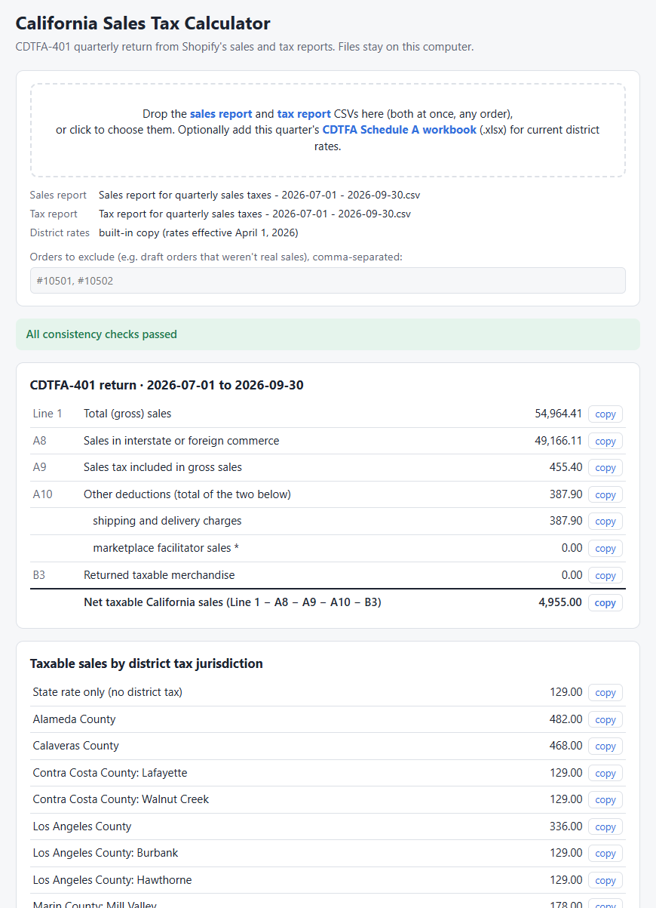

# California Sales Tax Return Calculator for Shopify

Calculates the numbers that you need for filing your California quarterly sales tax return (CDTFA-401) on the [state web site](https://onlineservices.cdtfa.ca.gov), calculated from two basic Shopify reports. No apps or subscriptions are needed. Everything runs in your browser. Your CSV files are never uploaded anywhere; you can read the code in
`index.html` to confirm this.

The important part is the list of your total sales in each California taxable district, for example: 
- $138 in San Diego County - Escondido
- $40 in Santa Clara County - San Jose
- $82 in Alameda County (outside of any city's tax district)
- ...

There's no single Shopify report that gives you this information, so it must be calculated by combining two reports.

**[Open the calculator](calculator.html)** — or download `calculator.html` and open it in any browser.

## Example Calculator Output

## What it calculates

- Line 1, Total (gross) sales
- Line A8, Sales in interstate or foreign commerce
- Line A9, Sales tax included in gross sales
- Line A10, Other deductions: shipping and delivery charges, plus sales through Shopify's Shop channel
  (where Shopify, as marketplace facilitator, collects and files the tax)
- Line B3, Returned taxable merchandise
- Taxable California sales for each district tax jurisdiction (county and city)

## Getting the reports from Shopify

Both reports must cover the same date range: the calendar quarter you're filing for. Shopify changes its
report menus from time to time, so names may differ slightly. 

### 1. Sales report

1. In the Shopify admin, go to **Analytics → Reports** and open **Total sales over time**.
2. Set the date range to the quarter. Turn off the comparison period if one is selected.
3. Under **Dimensions**, add **Sale ID**, **Order name** and **Shipping region**. A time dimension such as
   Day or Month can be removed.
4. Under **Metrics**, make sure these are included: **Gross sales**, **Discounts**, **Returns**,
   **Net sales**, **Shipping charges**, **Taxes**, **Total sales**, **Shipping returned**,
   **Taxes returned** and **Total returns**. The three "returned" metrics are usually not there by default,
   and returns can't be handled correctly without them.

### 2. Tax report

1. Go to **Analytics → Reports** and open **Taxes**.
2. Set the same date range.
3. Under **Dimensions**, add **Order name**. Check that **Tax name**, **Tax rate**, **Tax region**,
   **Tax country**, **Sales channel** and **Filed by channel** are present (they normally are by default).

Tip: use **Save as** to keep each configured report, so next quarter you only need to change the date range.

### 3. Export each report

1. Click **Export** (it may be under the **…** menu).
2. Choose **CSV**.
3. Select **All results from the data query**.

### 4. Run it

Open the calculator in your browser, and drag and drop both CSV files onto it. 

## Disclaimer

This is a calculation aid, not tax advice. Review the results, and the warnings it shows, before filing.
